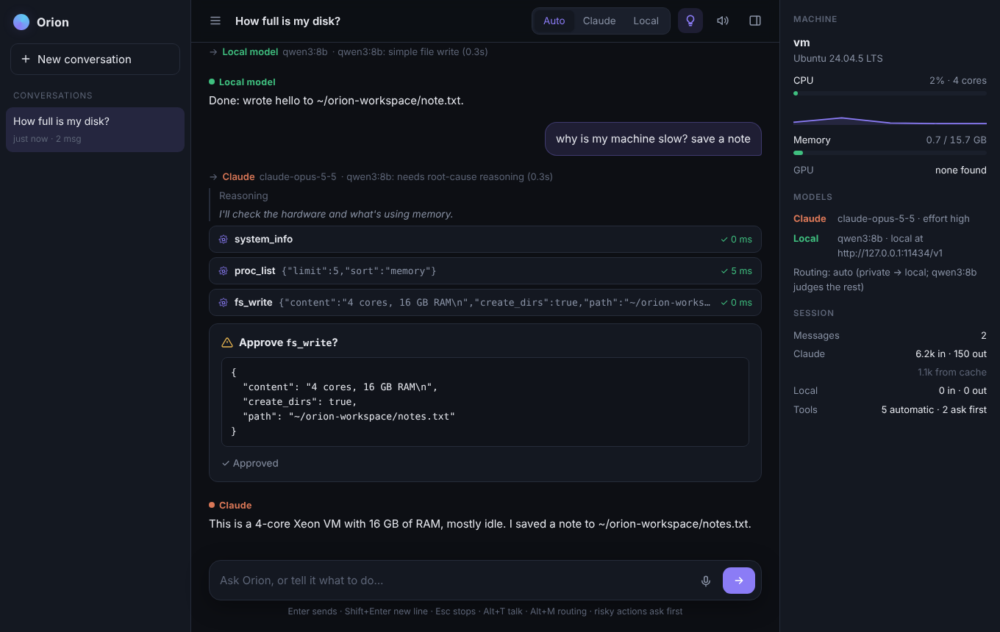

# Orion

Orion is an operating system built around AI: Linux underneath, with a model as a first-class user of the machine.

This repository holds the first pieces:

- **The interface between the AI and the system.** A model never touches the machine directly. It talks to `orion`, which offers the machine as a small set of typed tools. A local policy decides what is allowed, and every call is written to an audit log.
- **The front-end**, `orion chat`. You talk to an AI in your terminal, and it works on the machine through those same tools. Each message goes to Claude or to a model running on this machine's own hardware, whichever fits: private and simple work stays local, complex work goes to Claude. Anything risky stops and asks you first.
- **The system service**, `orion daemon`: one policy, one audit log and one sandbox shared by every agent on the machine, on a Unix socket only you can reach.
- **A model of the machine**: services, packages, the network, the GPUs and the local models on them, so the AI can see what is running and manage it, within a VRAM budget for models.
- **The sandbox.** Every program the AI starts with `proc_run` runs confined: read-only outside its workspace, with your keys and secrets hidden, no network, no GPU, and limits on memory, CPU time and file size.

```
   you ──▶ orion chat ──▶ Claude (API)  or  a local model (Ollama, llama.cpp, vLLM, …)
              │  ▲ approval prompts
              ▼  │
   ┌────────────────────────────┐   MCP (stdio)   ┌──────────────────────┐
   │ orion                      │ ◀────────────── │ any MCP client/agent │
   │  policy → tool → audit log │                 └──────────────────────┘
   └─────────────┬──────────────┘
                 ▼
      /proc, /sys, files, programs
```

It speaks the [Model Context Protocol](https://modelcontextprotocol.io), so the same interface works for hosted models, local models and future in-house agents. Nothing in it is tied to one vendor.

## Tools

| Tool           | Risk    | Default | What it does |
|----------------|---------|---------|--------------|
| `system_info`  | read    | allow   | Hostname, OS, kernel, CPU, memory, load, uptime |
| `gpu_info`     | read    | allow   | GPUs by vendor; for NVIDIA, memory, utilization, temperature and the processes using each card (`nvidia-smi`) |
| `net_info`     | read    | allow   | Interfaces and addresses, default routes, DNS, and listening ports with the process behind each |
| `fs_list`      | read    | allow   | Directory listing inside the readable roots |
| `fs_read`      | read    | allow   | Read a file, or a byte range of one, inside the readable roots |
| `fs_write`     | write   | ask     | Write or append to a file inside the writable roots |
| `proc_list`    | read    | allow   | Processes, with filtering and sorting by memory |
| `proc_run`     | execute | ask     | Run one program (no shell) in the [sandbox](#sandbox), with a timeout and an output cap |
| `svc_list`     | read    | allow   | systemd units: running, failed or stopped, and enabled at boot |
| `svc_status`   | read    | allow   | One unit's state, last result, memory, CPU, restarts and recent log |
| `svc_control`  | write   | ask     | Start, stop, restart, reload, enable or disable a unit (critical ones are protected) |
| `pkg_list`     | read    | allow   | Installed packages (apt, dnf or pacman) |
| `pkg_search`   | read    | allow   | Search the repositories |
| `pkg_info`     | read    | allow   | One package: installed and available versions, description, dependencies |
| `pkg_install`  | execute | ask     | Install packages, as root and outside the sandbox |
| `pkg_remove`   | execute | ask     | Remove packages, refused if the system or the policy needs them |
| `model_status` | read    | allow   | Local inference servers, their models (available and loaded), and the VRAM budget |
| `model_load`   | write   | ask     | Load a model on Ollama, within the VRAM budget (optionally unloading others) |
| `model_unload` | write   | ask     | Unload a model, freeing its VRAM |
| `model_pull`   | write   | ask     | Download a model onto Ollama |

Out of the box the AI can look at the machine freely. Changing it (writing files, running programs, managing services, packages and models) needs your approval each time. With no human present (`orion serve`), "ask" means no.

## Build

```sh
cargo build --release      # binary: target/release/orion
cargo test
```

Linux only, because the tools read `/proc` and `/sys` directly.

## Chat

```sh
export ANTHROPIC_API_KEY=sk-ant-...    # from console.anthropic.com
orion chat
```

```
Orion
  claude  claude-opus-5-5 · effort high
  local   qwen3:8b · local at http://127.0.0.1:11434/v1
routing: auto (private → local; qwen3:8b judges the rest) · 7 tools (5 automatic, 2 ask first) · /help · Shift-Tab switches routing

orion auto › what's eating my memory? write a short report

I'll check the hardware and the biggest processes.
  ⚙ system_info
    ✓ 0ms
  ⚙ proc_list {"limit":5,"sort":"memory"}
    ✓ 3ms
  ⚙ fs_write {"content":"…","path":"~/orion-workspace/memory.txt"}
  ? Approve fs_write?
    { "content": "…", "path": "~/orion-workspace/memory.txt" }
  [y]es / [n]o / [a]lways for this session › y
    ✓ 1ms
Firefox is using 3.1 GB of your 16 GB. I wrote the details to ~/orion-workspace/memory.txt.
```

- **Streaming.** Replies stream as they are written. The model's progress notes and reasoning show dimmed, so long tasks don't sit silent.
- **Every tool call is visible**, with its arguments and whether it worked.
- **Approval prompts** show the full arguments of anything that changes the machine. `a` approves that tool for the rest of the session.
- **Commands:** `/use`, `/route`, `/model`, `/models`, `/effort`, `/tools`, `/usage`, `/voice`, `/keys`, `/new`, `/history`, `/resume`, `/title`, `/exit`, plus `@claude` / `@local` prefixes and the [hotkeys](#hotkeys). Line history is kept in `~/.local/state/orion/chat_history`.
- Settings live under `[chat]` in the policy file: the mode (`provider = "auto"`, `"claude"` or `"local"`) and the sections `[chat.claude]` (model, default `claude-opus-5-5`; effort; progress notes; fallbacks), `[chat.local]` and `[chat.router]`.

`ANTHROPIC_AUTH_TOKEN` (an OAuth access token) also works in place of an API key.

### Graphical shell

```sh
orion shell            # prints an address like http://127.0.0.1:7310/?token=…
orion shell --open     # and opens it in your browser
```



`orion shell` serves Orion's graphical interface from this machine. It has the same conversation, routing, approvals and tools as the terminal chat, plus:

- **A sidebar of saved conversations.** Click one to continue it, or start a new one.
- **Routing at a glance:** an Auto / Claude / Local switch in the header (Alt+M cycles it), and every reply labeled with the model that wrote it and why.
- **Live tool activity:** each tool call shows a spinner, then its time or the error. Reasoning is collapsible (the bulb button, or Alt+R).
- **Approval cards** with Approve, Always allow this session, and Decline.
- **A machine panel:** CPU with a sparkline, memory, each NVIDIA GPU's load, VRAM and temperature, the connected models, and token use.
- **Voice:** the mic button (Alt+T) listens with a level meter and puts the transcript in the box. The speaker button reads replies aloud.
- **Shared across tabs.** Every open tab or window shows the same live conversation, and one that opens late, or reloads, is caught up.
- **Keyboard and layout:** Enter sends, Shift+Enter starts a new line, and Esc stops the AI. It follows the system's light or dark theme. On narrow screens the panels become slide-over drawers.

**Make it the whole desktop.** On a machine dedicated to Orion, boot straight into it with a kiosk Wayland compositor:

```sh
cage -- contrib/orion-kiosk      # starts `orion shell`, then a full-screen browser on it
```

[`contrib/orion-shell.service`](contrib/orion-shell.service) runs the shell as a systemd user service instead.

**Security.** A local web server is something other users and web pages could try to reach, so the shell is locked down:

- **It listens on `127.0.0.1` only.** For another machine, use an SSH tunnel.
- **Every run gets a random 128-bit token.** The printed address carries it, and on first load it is swapped for an `HttpOnly`, `SameSite=Strict` cookie and removed from the address bar. The address is also saved, readable only by you, in `~/.local/state/orion/shell-url`.
- **Requests must name this server in `Host`,** which defeats DNS-rebinding attacks.
- **Anything that changes state needs an `X-Orion` header.** A cross-site page can only send that after a CORS preflight, and the shell never approves one.
- **The page loads nothing from outside,** and a strict Content-Security-Policy enforces it. Model output is HTML-escaped before it is rendered as Markdown.

### Full-screen interface

On a terminal, `orion chat` opens full screen:

```
┌ Orion · why is my machine slow? save a note ───────────────────────────────────┐┌ Machine ─────────────────────────┐
│you     why is my machine slow? save a note                                     ││ vm                               │
│        → Claude (claude-opus-5-5) · qwen3:8b: needs root-cause reasoning (0.3s)││ Ubuntu 24.04.5 LTS               │
│        I'll check the hardware and what's using memory.                        ││ CPU  ██░░░░░░░░  18% ·4c         │
│        ⚙ system_info   ✓ 0ms                                                   ││ RAM  ██████░░░░ 9.1/16G          │
│        ⚙ proc_list {"limit":5,"sort":"memory"}  ✓ 4ms                          ││ GPU0 RTX 4070                    │
│        ⚙ fs_write {"content":"4 cores, 16 GB RAM\n","create_dirs"…  ✓ 0ms      ││  use ████░░░░░░  42% 61°C        │
│        ┌─ Approve fs_write?                                                    ││  mem ███░░░░░░░ 3.1/12G          │
│        │ { "path": "~/orion-workspace/notes.txt", … }                          ││ Routing                          │
│        └─ approved                                                             ││ auto (private → local; qwen3:8b  │
│claude  This is a 4-core Xeon VM with 16 GB of RAM, mostly idle. I saved a note ││ judges the rest)                 │
│        to ~/orion-workspace/notes.txt.                                         ││ claude claude-opus-5-5 · effor…  │
│                                                                                ││ local  qwen3:8b · local at htt…  │
│                                                                                ││ Session                          │
│                                                                                ││ claude in 6.2k · out 150         │
└────────────────────────────────────────────────────────────────────────────────┘└──────────────────────────────────┘
┌ message · Enter sends · Alt-Enter new line ────────────────────────────────────────────────────────────────────────┐
│›                                                                                                                   │
└────────────────────────────────────────────────────────────────────────────────────────────────────────────────────┘
 AUTO   Shift-Tab routing · Ctrl-O reasoning · Ctrl-B panel · PgUp/PgDn scroll · /keys · Ctrl-D quit
```

- **The conversation:** your messages, routing decisions, reasoning (dimmed), every tool call with a live status (`…`, then `✓ 12ms` or `✗` with the error), and replies. Code blocks are highlighted.
- **Approvals appear as cards** in the conversation, and you answer them with `y`, `n` or `a` (always, for this session).
- **The machine panel** (Ctrl-B) shows live CPU and RAM, each NVIDIA GPU's load, VRAM and temperature, which models are connected and how routing works, and token use per model. It reads the machine directly, so polling never fills the audit log.
- **The screen stays live while the AI works.** The conversation runs on its own thread, so you can scroll, read, or type your next message ahead. It sends when the AI is done.
- **The status bar** shows the routing mode, a spinner while working, and the key hints.
- **Keys:** the [hotkeys](#hotkeys) below work the same here. Also Ctrl-B (the panel), PgUp/PgDn or the mouse wheel (scroll; End jumps back to the latest), and Ctrl-J or Alt-Enter (new line). Pasted text keeps its line breaks. The mouse is captured for scrolling; hold Shift to select text in most terminals.
- **Resuming** shows the whole earlier conversation above a "resumed" divider.

`orion chat --plain`, or `interface = "plain"` under `[chat]`, keeps the line-by-line chat, and it's used automatically when input or output isn't a terminal. Both interfaces share the same session, commands and keys.

### Voice

Press **Ctrl-T** and talk. A live level meter shows Orion is listening. When you pause, the recording ends (or press Ctrl-T again full screen, Enter in the line chat; Esc or Ctrl-C cancels). Your words land in the message box to check and edit before you press Enter.

```
┌ ● listening ▁▁▁▆▆▆▆▆▆▅▅▅ 1s · pause or Ctrl-T to finish · Esc cancels ───────────┐
│›                                                                                 │
└──────────────────────────────────────────────────────────────────────────────────┘
┌ message · Enter sends · Alt-Enter new line ──────────────────────────────────────┐
│› how full is my disk?                                                            │
└──────────────────────────────────────────────────────────────────────────────────┘
```

`/voice speak on` makes Orion **speak its replies**, sentence by sentence as they stream in. Code blocks are left on screen ("code shown on screen"), and Markdown symbols are not read out. Ctrl-C, or starting your next message, stops it mid-sentence. `/voice` shows what is set up, and `/voice test` says a test sentence.

It is local-first and uses what the machine already has:

| Part | Default | Alternatives |
|---|---|---|
| Microphone | the first of `parecord` (PulseAudio/PipeWire), `arecord` (ALSA), `sox`, `ffmpeg` | any command writing 16 kHz mono 16-bit PCM to stdout (`record_command`) |
| Speech to text | an OpenAI-compatible server at `http://127.0.0.1:8000/v1`, such as [speaches](https://github.com/speaches-ai/speaches) (faster-whisper), LocalAI, or whisper.cpp's server | a command that prints the transcript, for example `whisper-cli … -f {wav}` (`transcribe_command`) |
| Text to speech | `espeak-ng`, `espeak` or `spd-say` | [piper](https://github.com/rhasspy/piper) as a command, or an OpenAI-compatible `/audio/speech` server such as Kokoro-FastAPI (`speak_url`) |

- **Listening ends on a pause.** Orion measures the room's noise floor at the start and waits for at least 0.3 s of speech before a pause can end the recording, so a click doesn't cut you off.
- **Transcripts are cleaned up.** Whisper's `[BLANK_AUDIO]`-style markers are removed.
- **A spoken message is routed like a typed one,** so private speech stays on the local model.
- **Nothing is sent off the machine** unless you point `transcribe_url` or `speak_url` at a remote server.
- **Settings are under `[voice]`.** Set `send_after_transcribe = true` to send without the editing step.

#### Wake word

Turn on wake listening with **Alt-W** (or `/voice wake on`, or `wake = true` under `[voice]`), and talk to Orion hands-free in the full-screen chat or the shell:

- **"Orion, what's using the GPU?"** is sent at once, as if you had typed it.
- **A bare "Orion"** plays a short chime, and the next thing you say is the request: `● listening · say your request`.
- **"Hey Orion", "OK Orion"** work too. The phrase only counts at the start of what you say, so "I read about Orion" doesn't wake it.
- **Spoken requests act like typed ones.** While the AI is working, they wait their turn, and "Orion, stop" interrupts it.
- **Spoken "no" declines an approval.** A spoken "yes" approves only with `wake_approvals = true`, because anything playing audio nearby could say it.

How it works: the microphone stays open, and a pause detector (with a noise floor that follows the room) cuts the sound into utterances. The first 3 seconds of each utterance go to your transcriber and are checked for the wake phrase. The check allows for the ways a transcriber spells a name it doesn't know ("O'Ryan", "Orien", "Oreon"), and `wake_aliases` adds your own. Utterances are only held in memory until they are checked, and nothing is saved.

- **It stays local.** Wake listening refuses to start if your transcriber is on another machine, since everything said near the microphone would go there. Set `wake_allow_remote = true` if that is really what you want.
- **A dedicated detector:** set `wake_command` to a program that prints a line each time it hears the wake word, such as an [openWakeWord](https://github.com/dscripka/openWakeWord) or Porcupine script. It does the always-on listening, so nothing is transcribed until it fires, and Orion then records and transcribes the request.
- **The cost:** transcribing every utterance is light with a GPU or a small Whisper model, but a dedicated detector uses far less power on a CPU.
- **Your own phrase:** `wake_phrase` sets it, for example `"hey computer"`. A short, distinctive name works best.
- **No leftover microphone:** the microphone is closed as soon as wake listening stops, and it can't outlive Orion even if Orion is killed.
- **The line-by-line chat** can't take input while it waits at its prompt, so wake listening is only in the full-screen chat, the shell and [headless voice](#headless-voice).

#### Speaker verification

Enroll your voice and only you can wake Orion. Other people, and the television, are ignored.

```sh
orion voice enroll     # say six short phrases; about a minute
orion voice test       # say anything: "That's you: 0.94" or "doesn't sound like the enrolled voice: 1.91"
orion voice status
orion voice forget     # anyone can wake Orion again
```

- **It applies wherever Orion listens for its wake word:** the full-screen chat, the shell and `orion listen`. It covers spoken approvals too, so "Orion, yes" from someone else approves nothing. Ctrl-T recordings aren't checked, since you're at the keyboard.
- **Other voices are never transcribed.** Each utterance is checked before anything transcribes it, and one in another voice is dropped. Their words never reach the transcriber, and `/voice` shows how many were ignored.
- **A bare "Orion" is often too short to judge** (under 0.4 s of speech), so it may wake Orion, but the request that follows is judged together with it and must match. If it doesn't, the chat and the shell show "that didn't sound like your voice", and `orion listen` says "Sorry, I didn't recognize your voice."
- **How it works:** no model to download, and it runs on this machine in milliseconds. Each 10 ms of speech becomes 19 mel-cepstral coefficients and their deltas. Enrollment summarizes your phrases as a codebook of 32 typical frames, and a new utterance is scored by how far its frames lie from that codebook, relative to how far your own phrases lie from a codebook built without them. That ratio is about 1 for you, whatever you say; the default limit is 1.2 (`verify_threshold`, lower is stricter).
- **How well it works:** on 8 synthesized voices (espeak-ng) with six enrollment phrases each, it rejected none of 48 new phrases from the enrolled voice and accepted 4 of 648 phrases from other voices (0.6%). Two voices with the same vocal tract and a different pitch accepted each other: it tells vocal tracts apart, not pitch. A noisy room makes false accepts more likely. Enroll where you usually talk to Orion, with the same microphone, and enroll again if the room or microphone changes.
- **It keeps other voices out; it isn't proof of identity.** A recording of you gets through, and so may a very similar voice, which is why spoken approval stays off unless you turn on `wake_approvals`.
- **The voiceprint** is `~/.local/state/orion/voiceprint.json`, readable only by you. It holds averaged sound features that can't be turned back into speech. Programs the AI runs can't see it; the sandbox hides Orion's whole state directory.
- **Settings:** `verify_speaker = "auto"` (on once a voice is enrolled; `"on"` refuses to listen without one, `"off"` never checks) and `verify_threshold` under `[voice]`.

#### Headless voice

`orion listen` is Orion with no screen at all: it listens for the wake phrase, works on what you ask, and speaks the answer. That makes it a voice assistant for the machine, made to run as a service.

```sh
orion listen                        # until stopped; --local / --claude / --auto, --resume
systemctl --user enable --now orion-voice.service    # or as a user service (contrib/)
journalctl --user -u orion-voice -f                  # what it heard and said
```

```
Orion is listening: say "orion" (heard by Systran/faster-whisper-small at http://127.0.0.1:8000/v1)
approvals by voice: on ("Orion, yes")
you: how long has this machine been up?
⚙ proc_run {"command":"uptime"}
asking: May I run uptime?
you: yes. (approved)
  ✓ 22ms
orion: The machine says: up 35 min, load average: 0.45, 0.25, 0.21.
```

- **The same conversation engine.** Routing, tools, the policy, the sandbox, the audit log and saved conversations all work as in the chat. A new conversation starts when the last request is more than 10 minutes old (`listen_new_after_mins`).
- **Approvals are asked aloud.** With `wake_approvals = true`, Orion asks "May I restart ollama? Say Orion yes, or Orion no." and waits 30 seconds for an answer; silence or anything else counts as no. With it off (the default), tools that need approval are declined, and Orion says so. Pre-approve what you want it to do freely in the policy (`[tools]`, `proc.allowed_commands`, `services.allowed`, …).
- **Hands-free control:** "Orion, stop" interrupts the AI. A request made while it is working waits its turn ("I'll do that next."). Errors are spoken briefly and logged in full.
- **It needs all three parts:** a microphone, speech to text and speech. It names whatever is missing at startup. If the microphone fails later, it tries again every 10 seconds.
- **Only one listener:** run either this or wake listening in a chat or shell, not both, or both will answer.

### Saved conversations

Every conversation is saved after each message, so closing the terminal (or a crash) loses nothing:

```sh
orion chat --resume               # continue the most recent conversation
orion chat --resume 20261020-15   # or a specific one, by id or id prefix
orion conversations               # list them: id, last active, length, title
orion conversations show <id>     # print a transcript
orion conversations delete <id>
```

```
Resumed “Cleanup plan” · 3 messages
  you: second message
  claude: Reply 1.
  you: third message
  claude: Reply 2.
```

Inside a chat:

- `/history` lists saved conversations, most recent first.
- `/resume <n|id>` switches to one; the current conversation is already saved.
- `/new` starts a fresh conversation.
- `/title <text>` renames the current one. Titles otherwise come from the first message, and a conversation that starts with a private message is titled "(private conversation)".

How it works:

- **Each model's own history is saved exactly as it was produced,** alongside the shared transcript. Claude's thinking blocks and their signatures are included, so a resumed conversation continues with full context (and prompt caching), not from a summary. Each model's id is saved too, and comes back on resume unless you pass `--model`.
- **The routing mode comes back as well.** If that mode's model is gone (say the local server is off), the conversation continues in `auto`. A model that isn't connected when you resume keeps its saved history in the file, and gets it back as soon as it connects (with `/use` or Shift-Tab).
- **Files live in `~/.local/state/orion/conversations/`** (`$XDG_STATE_HOME`), one JSON file per conversation. They are readable only by you (the folder is `0700`, the files `0600`) and written atomically. They hold private turns too, which never leave the machine. Set `save_conversations = false` under `[chat]` to stop saving.

### Hotkeys

| Key | What it does |
|---|---|
| **Ctrl-C** | Stops the AI mid-turn: a streaming reply, a long think, a running program or an approval prompt. Any partial reply is kept and marked as interrupted, so the model knows where it stopped. At the prompt, press it twice to quit. |
| **Shift-Tab** | Cycles routing between auto, claude and local, keeping what you've typed. Models that can't be reached are skipped. |
| **Ctrl-T** | Talks: listens until you pause, then puts what you said in the message box. See [Voice](#voice). |
| **Alt-W** | Turns [wake-word listening](#wake-word) on or off (full screen and the shell). |
| **Ctrl-O** | Shows or hides reasoning and progress notes (default: `show_reasoning` under `[chat]`). |
| **Alt-Enter** | Starts a new line, for multi-line messages. Pasting multi-line text also works. |
| **Ctrl-R**, **↑ ↓** | Search and browse your earlier messages. |
| **Ctrl-L** / **Ctrl-D** | Clear the screen / quit. |

The prompt shows the current routing (`orion auto ›`), and `/keys` lists the hotkeys. What Ctrl-C does underneath:

- **Network calls run on a worker thread.** The chat walks away from them, and the connection is dropped, which stops generation on the server rather than letting it run on in the background.
- **Programs started by the AI are killed** along with their whole process group.
- **An open approval prompt counts as "no".**
- **Every tool call the model already made still gets an answer** ("interrupted by the user"), so the conversation stays valid for the next message.
- **An interrupt is never treated as a failure,** so it doesn't trigger a fallback to the other model.
- **A second Ctrl-C** before the first is handled quits Orion outright, as an escape hatch if something hangs.

### Automatic routing

With both Claude and a local model available, `orion chat` (mode `auto`, the default) picks a model for every message and says which one it chose and why:

```
orion auto › how full is my disk?
→ the local model (qwen3:8b) · short request
  ⚙ proc_run {"args":["-h","/"],"command":"df"}
Your root disk is 28% full.

orion auto › plan a cleanup of my home directory
→ Claude (claude-opus-5-5) · complex: "plan"
Plan: 1) clear ~/.cache (2.1 GB), 2) empty Trash, 3) prune old Downloads. Start with the cache?

orion auto › yes
→ Claude (claude-opus-5-5) · follow-up

orion auto › my bank password is hunter2, remember it
→ the local model (qwen3:8b) · private: mentions "password"
```

How it decides, in order:

1. **Private stays local.** A message is private if it contains a private word (password, bank, medical, …), something shaped like a key or token, or one of the `private_paths`. If no local model is available, Orion asks before sending it to Claude. This is always a rule; no model can overrule it.
2. **Short follow-ups** ("yes", "ok, go ahead", "thanks") stay with the model that answered last.
3. **Everything else is judged on difficulty by the local model.** It is given a description of both options and the previous message, and answers `{"route": "claude"|"local", "reason": "…"}`. Its reason and how long it took are shown (`→ Claude (claude-opus-5-5) · qwen3:8b: multi-step migration planning (0.3s)`). When unsure it picks `prefer` (local by default).
4. **If no local model is running, or the judge fails or times out,** keyword rules decide instead. They send code, complex words (debug, refactor, plan, explain, write, …), several questions or numbered steps, and long messages to Claude, and everything else to `prefer`. After three failures in a row the judge is switched off for the session. Set `strategy = "rules"` to always use the rules; they're instant, and cruder.
5. **If the chosen model is down, or fails before replying, the other one answers.** Private messages never fall back to Claude.

The judge runs on this machine, so a message is never sent to Claude just to decide where it should go, and private messages never reach the judge at all. A small, fast model works well as the judge (`classifier_model = "qwen3:1.7b"`) while a bigger one handles the chat. Orion asks for JSON mode and no reasoning pass (`chat_template_kwargs`), and if the server rejects those fields it retries without them, and remembers.

**One conversation, two models.** Before a model answers, it is caught up on the turns the other model handled: their messages, replies and tool calls. Switching never loses context. **Private turns are never shown to Claude**, now or later.

**Claude never sees private files.** When Claude is answering, any tool call that refers to a `private_paths` entry (`~/.ssh`, `~/.gnupg`, `~/.aws`, …) is refused before it runs, whatever the policy allows. The check catches relative paths and symlinks too. The local model is not restricted this way.

Control it with:

- `@claude …` or `@local …` sends one message to that model.
- `/use auto|claude|local` switches mode; the conversation carries over.
- `/route <text>` shows where a message would go. Only the local judge sees it.
- `orion chat --auto`, `--claude` and `--local` choose the starting mode.
- The rules (word lists, private paths, `prefer`, length threshold) are configured under `[chat.router]`; see [`orion.example.toml`](orion.example.toml).

### Local models

Orion can use a model running on your own GPU instead of Claude. Nothing leaves the machine, and no API key is needed. It speaks the OpenAI-compatible chat API (`/v1/chat/completions`, with streaming and tool calls), which every major local runtime serves:

| Runtime | Start it | `[chat.local] base_url` |
|---|---|---|
| [Ollama](https://ollama.com) | `ollama pull qwen3:8b` (the server runs as a service) | `http://127.0.0.1:11434/v1` (default) |
| llama.cpp | `llama-server -m model.gguf --jinja` | `http://127.0.0.1:8080/v1` |
| vLLM | `vllm serve Qwen/Qwen3-8B --enable-auto-tool-choice --tool-call-parser hermes` | `http://127.0.0.1:8000/v1` |
| LM Studio | start the local server in the app | `http://127.0.0.1:1234/v1` |

```sh
orion chat --local                    # only the local model: first one the server lists
orion chat --local --model qwen3:8b   # a specific one
```

Inside a chat, `/models` lists what the server has, and `/model local <id>` switches model.

Things to know:

- **Pick a model trained for tool calling.** Qwen3, Llama 3.1+, Mistral Small 3 and gpt-oss work well. Smaller models (under ~7B) often call tools badly or not at all.
- **Context length matters.** Orion's tool definitions plus the results of a few calls fill a small window fast. Ollama's default context is short; raise it with `OLLAMA_CONTEXT_LENGTH=32768`, or with `-c` on llama-server.
- **Reasoning display.** Models that reason (Qwen3, DeepSeek-R1, gpt-oss) show their reasoning dimmed, whether the server sends it separately (`reasoning_content` / `reasoning`) or inline in `<think>` tags. It is not sent back to the model in the history.
- **The same policy applies.** A local model gets exactly the tools, approvals and audit log that Claude does.

## Other commands

```sh
orion tools                                   # every tool, its risk, and the policy decision
orion call system_info                        # call a tool yourself, exactly as the AI would (prompts for "ask" tools)
orion call fs_list '{"path": "~"}'
orion audit -n 20                             # recent calls, as JSON lines
orion conversations                           # saved chats (see "Saved conversations")
orion shell                                   # the graphical shell (see "Graphical shell")
orion listen                                  # headless voice: "Orion, …" (see "Headless voice")
orion voice enroll                            # only your voice wakes Orion (see "Speaker verification")
orion serve                                   # MCP server on stdin/stdout (through the daemon when it runs)
orion daemon                                  # the system service (see "System service")
orion status                                  # whether the daemon runs, and how
```

### Connect a model

Any MCP client can launch `orion serve`. For Claude Code:

```sh
claude mcp add orion -- /path/to/orion serve
```

Or in a client's JSON config:

```json
{ "mcpServers": { "orion": { "command": "/path/to/orion", "args": ["serve"] } } }
```

## The machine

Beyond files and processes, the AI sees and manages the parts of the machine an AI-first system cares about.

### Services

`svc_list`, `svc_status` and `svc_control` work on systemd units: the machine's (`scope: "system"`, the default) or your own (`"user"`).

- **`svc_status` explains failures:** state, the last result (`exit-code`, `oom-kill`, …), restarts, memory, CPU time and the last log lines. When `svc_control` fails, the log comes with the error.
- **Protected units can't be touched,** whatever you approve: ssh, networking, the display manager, `systemd-*`, D-Bus, polkit, logins, every `.target` (so no `reboot.target`) and Orion itself. Edit `[services] protected` to change the list. Only services, sockets, timers and paths can be controlled at all.
- **`[services] allowed`** lists units the AI may control without asking (wildcards work), like `["ollama.service", "llama-server.service"]`.
- **Root:** as a normal user, system units are tried directly first, which polkit may allow. If polkit refuses, Orion retries with `sudo -n`; see `[admin] elevate`.

### Packages

`pkg_list`, `pkg_search`, `pkg_info`, `pkg_install` and `pkg_remove` drive apt, dnf or pacman (detected automatically, or set `[packages] manager`).

- **Nothing runs on a bad request.** Names that could be read as options are refused. On apt, the change is simulated before you are asked, so unknown packages fail first, and the result lists every package that changed, dependencies included.
- **Removal is guarded.** A removal is refused, before you are asked, if it would take away a package the system marks essential or required, or one in `[packages] protected` (the kernel, systemd, sudo, ssh, libc, the package manager, bubblewrap, …). That holds even when the package would only go as a dependent of what you named.
- **`[packages] allowed`** pre-approves installs by name (wildcards work), e.g. `["python3-*"]`.
- **Installs run as root and outside the sandbox,** because package scripts need that. That is why both tools are `execute`. As a normal user Orion uses `sudo -n`, which needs a `NOPASSWD` rule for the package manager, or set `[admin] elevate = "pkexec"` for a graphical password prompt.

### Network

`net_info` reports each interface (kind, state, MAC, addresses, traffic), the default IPv4 and IPv6 routes, the DNS servers (including systemd-resolved's real upstream servers), and every listening TCP and UDP port with the process behind it. As a normal user, owners show only for your own processes.

### Local models and VRAM

`model_status` finds the inference servers on this machine: `chat.local.base_url`, anything in `[models] servers`, and whatever answers on the usual ports (Ollama 11434, llama.cpp 8080, vLLM 8000, LM Studio 1234). For each it shows the kind, the process serving it, the models it offers (with their size and estimated VRAM need), and on Ollama what is loaded, how much of it is on the GPU, and when it expires. Next to that is the GPU ledger: each card's memory, the processes using it, and what is free for models.

- **The VRAM budget** is each GPU's memory less `[models] vram_reserve_mb` (1 GiB by default, for the desktop and other programs), less what is already in use. `model_load` checks a model fits before you are asked: about 1.15 × its size plus 512 MiB, for the KV cache and buffers.
- **If it doesn't fit,** the load is refused with what is in the way. With `evict: true` Orion first unloads the models due to expire soonest (the least recently used), only as many as needed.
- **`keep_alive`** sets how long a model stays loaded after its last use (`[models] keep_alive`, default `30m`; `-1` keeps it loaded).
- **Loading and pulling work on Ollama.** llama.cpp, vLLM and LM Studio serve one fixed model each; manage those as services with `svc_control`.
- The machine panel in the full-screen chat and the shell lists the loaded models with their VRAM, and any failed services.
- Without NVIDIA readings (no `nvidia-smi`), loads aren't budgeted and `model_status` says so.

## System service

`orion daemon` runs Orion as a long-lived service, so every agent on the machine shares one policy, one audit log and one sandbox:

```sh
orion daemon &      # or as a systemd user service, below
orion status
# Orion daemon: running, pid 4121, up 2h 13m
# socket:       /run/user/1000/orion/orion.sock
# policy:       /home/you/.config/orion/orion.toml (1 reload)
# tools:        5 allowed, 2 ask, 0 denied
# sandbox:      bubblewrap, read-only outside the writable roots, private paths hidden, no network, no GPU
# agents:       2 connected, 9 since start
# tool calls:   41
# audit log:    /home/you/.local/state/orion/audit.jsonl
```

- **`orion serve` becomes a thin bridge.** When the daemon is running, `orion serve` connects to it and relays the MCP session, so nothing changes for clients: they still launch `orion serve`. With no daemon, or with `--direct` or an explicit `--config`, it serves in-process as before.
- **It speaks MCP over a Unix socket** at `$XDG_RUNTIME_DIR/orion/orion.sock` (`[daemon] socket` changes it). The socket is `0600` in a `0700` directory, Orion refuses to start if that directory belongs to someone else or is open to others, and every connection's peer is checked with `SO_PEERCRED` (your uid, or root).
- **Policy edits apply live.** The daemon watches the policy file and reloads it within two seconds; connected agents see the new tool list on their next call. A broken edit is reported in `orion status`, and the old policy stays in force.
- **The audit log names the caller.** Each entry carries the client's name and pid (`"caller": "claude-code (pid 5312)"`), so you can tell agents apart.
- **`orion status`** adds an `orion/status` method that any client can call; it exits 1 when the daemon isn't running.

### As a systemd service

`contrib/orion.socket` and `contrib/orion.service` set up a socket-activated user service: systemd holds the socket and starts the daemon on the first connection.

```sh
cp contrib/orion.socket contrib/orion.service ~/.config/systemd/user/
systemctl --user daemon-reload
systemctl --user enable --now orion.socket
```

The service reads `ANTHROPIC_API_KEY` and other variables from `~/.config/orion/env`, caps everything Orion runs at 8 GiB of memory and 1024 tasks through its cgroup, and hardens the daemon itself (`NoNewPrivileges`, `ProtectKernel*`, `RestrictSUIDSGID`, …). `journalctl --user -u orion` shows its log.

## Sandbox

Every program the AI starts with `proc_run` runs in a sandbox, whatever the policy allows it to run. `orion tools` and `orion status` show which one, and the model is told, so it reports a refusal instead of trying to get around it. (The machine tools' own fixed commands, such as `systemctl` and the package manager, run outside it. Those tools take checked arguments, not programs, and have their own rules and protected lists.)

| | bubblewrap | Landlock | limits only |
|---|---|---|---|
| Filesystem | read-only, except the `write_roots` and a private `/tmp` | read-only, except the `write_roots`, `/tmp`, `/var/tmp`, `/dev/shm` | as the user |
| Private paths (`~/.ssh`, `~/.gnupg`, …) | hidden: they don't exist | unreadable | readable |
| Network | none (own network namespace) | no TCP connect or bind (kernel ABI 4+) | open |
| GPU | no devices | no devices | open |
| Other | own PID, IPC and hostname namespaces, all capabilities dropped | can't signal or reach abstract sockets outside the sandbox (ABI 6+) | |
| Memory, CPU time, file size, no core dumps, no privilege gain | ✓ | ✓ | ✓ |

- **`mode = "auto"`** uses bubblewrap if it is installed and works (`apt install bubblewrap`), else Landlock (Linux 5.13+, no install needed), else only the limits. `require = true` refuses to run programs rather than fall back to limits only.
- **Hidden paths** are `[sandbox] hide` (your keys, password store, cloud credentials and Orion's own config, so a program can't loosen its policy) plus `chat.router.private_paths`, and always Orion's state directory (conversations, the audit log, the shell's token, the voiceprint).
- **`network = true`** and **`gpu = true`** open those up, for example for package installs or CUDA work. Landlock can only restrict TCP, so for a full network block install bubblewrap.
- **Limits** are per program: `memory_mb` (default 8192), `cpu_secs` (300) and `max_file_mb` (4096); `0` turns one off. Programs also can't gain privileges through setuid binaries.
- Each result says which sandbox ran it (`"sandbox": "bubblewrap"`), and `orion tools` prints the current one.
- Under Landlock, a directory that contains a hidden path is opened up entry by entry, so files created there later aren't readable. Bubblewrap has no such gap.

## Policy

Copy [`orion.example.toml`](orion.example.toml) to `~/.config/orion/orion.toml`, or point `--config` or `ORION_CONFIG` at a file.

- `[defaults]` sets `allow`, `ask` or `deny` for each risk level (`read`, `write`, `execute`).
- `[tools]` overrides individual tools. A model is only offered tools it could actually use: `orion chat` offers `allow` and `ask` tools, and `orion serve` offers only `allow` tools.
- `[fs]` sets `read_roots` and `write_roots` (default `~/orion-workspace`). These are hard limits, checked *before* you are asked, so you never approve a call that would fail. Paths are canonicalized before the check, so `..` and symlinks cannot escape a root, and writes to paths that don't exist yet are checked through their nearest real ancestor.
- `[proc]` sets `allowed_commands`: pre-approved programs, matched exactly. When `proc_run` is `ask`, these run without a prompt and anything else asks. When it is `allow`, only these run at all. `[proc]` also sets a timeout and an output cap. Once a program exits or times out, its whole process group is killed, so background children cannot linger.
- `[audit]` controls the append-only JSONL log at `~/.local/state/orion/audit.jsonl`. It records each decision and, for `ask`, your answer. Long string arguments are truncated in the log.
- `[chat]` holds the front-end settings above.
- `[services]`, `[packages]`, `[models]` and `[admin]` configure [the machine](#the-machine) tools.
- `[sandbox]` and `[daemon]` configure the [sandbox](#sandbox) and the [system service](#system-service).

Unknown keys are an error, so a misspelled setting fails loudly instead of being ignored.

## Layout

```
src/
  lib.rs        Orion: the registry that applies the policy and audit to each call
  tool.rs       the Tool trait and risk levels
  policy.rs     policy file, decisions, path scoping
  audit.rs      JSONL audit log
  mcp.rs        MCP server (initialize, ping, tools/list, tools/call)
  daemon.rs     the system service: socket, peer checks, live reload, the stdio bridge
  sandbox.rs    sandboxing for proc_run: bubblewrap, Landlock, resource limits
  tools/        built-in tools: system (and GPUs), fs, process, network, services
                (systemd), packages, models (inference servers, VRAM budget);
                exec.rs runs programs for them
  chat/
    mod.rs      config, the Backend and Ui traits
    session.rs  one conversation across both models: routing, catch-up, fallback, tool loop
    router.rs   the routing order, keyword rules and the private-path guard
    classifier.rs  the local model as routing judge
    claude.rs   Claude backend: streaming Messages API client (SSE)
    local.rs    local backend: OpenAI-compatible chat completions (Ollama, llama.cpp, vLLM, LM Studio)
    http.rs     shared HTTP: retries, proxy rules, error bodies, SSE lines
    store.rs    saved conversations: atomic, private JSON files
    terminal.rs the line-by-line chat, shared commands, `orion conversations`
    agent.rs    the conversation's own thread, shared by the full-screen chat, the shell
                and headless voice
    listen.rs   headless voice (`orion listen`): wake, spoken replies, spoken approvals
    machine.rs  live CPU, memory and GPU readings for status displays
    tui/        the full-screen chat: screen and keys (mod.rs), the message editor (input.rs)
    shell/      the graphical shell: server, event hub and security (mod.rs),
                minimal HTTP (http.rs), the page (shell.html)
  interrupt.rs  Ctrl-C: the SIGINT flag, interruptible waits and reads
  voice/        listening and the pause detector (record.rs), speech to text
                (transcribe.rs), text to speech and sentence splitting (speak.rs),
                the wake word (wake.rs), speaker verification (speaker.rs) and
                enrolling a voice (enroll.rs)
contrib/        orion.socket and orion.service (the daemon), orion-voice.service
                (headless voice), orion-kiosk (boot into the shell), orion-shell.service
tests/          end-to-end runs of the real binary: stdio.rs (MCP), daemon.rs
                (daemon plus bridge)
```

To add a capability, implement `Tool` in `src/tools/` and register it in `tools::builtin()`. Pick its `Risk` honestly, because that is what the policy defaults key off. Put checks that no approval should override in `precheck`, and argument-dependent pre-approval (like `proc_run`'s command list) in `preapproval`.

## Roadmap

1. ~~**Interactive approval.**~~ Done in `orion chat`, via the `ask` decision.
2. ~~**System daemon.**~~ Done: `orion daemon`, socket-activated by systemd, with `orion serve` as the bridge. Next: run `orion chat` and the shell through it too, and route `ask` approvals from MCP agents to you.
3. ~~**Isolation.**~~ Done: bubblewrap or Landlock with per-program limits. Next: a cgroup per call (memory including page cache, GPU memory budgets) and a seccomp filter.
4. ~~**Richer machine model.**~~ Done: services, packages, network, and local models within a VRAM budget. Next: GPU placement (which card a model goes on), network changes (Wi-Fi, firewall), disks and mounts, and updates.
5. **Front-end, next steps.** ~~A terminal chat~~, ~~local models~~ and ~~automatic routing~~ (rules plus a local-model judge) are done. ~~Hotkeys~~ (Ctrl-C to interrupt, Shift-Tab, Ctrl-O), ~~saved conversations~~, ~~a full-screen TUI~~, ~~voice~~, ~~a graphical shell~~ and ~~wake-word listening~~ are done too. A ~~headless voice mode~~ (`orion listen`) and ~~speaker verification~~ are done too. Next for voice: a neural speaker model as an option (stronger against similar voices), and several enrolled people.
